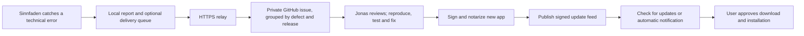

# Bug reports and app updates

Implemented on 19 October 2026. Current published package: **Sinnfaden 0.4.4, build 9** (20 October).

The prompt-visibility fix is installed, live-tested and published as **0.4.4/build 9**, with 201 passing automated tests. A separate build-8 copy successfully updated to the exact signed build-9 archive. The Applications copy restored its saved account and immediately displayed a real generated prompt. See [build-9 verification](RELEASE-0.4.4.md).

Deployment follow-up: the report relay and signed update host are now deployed on Cloudflare's **Free ($0)** plan. The signing key is in this Mac's Keychain. See [free hosting and release operations](FREE-HOSTING.md) for the live addresses, token setup and development-distribution limitations. The steps below also explain how to reconnect credentials or move to production signing later.

## What works locally

- Settings → **Updates & Fehler** shows technical reports, their occurrence counts and delivery state. Reports can be exported or deleted locally.
- Automatic reporting is off by default. It becomes available when the app is built with a valid reporting URL. Enabling it queues new reports only; it does not upload earlier local reports. Disabling it cancels pending delivery and removes pending delivery flags. A request already accepted remotely cannot be recalled.
- Only component, fixed error category, HTTP status, release/build and a random report ID are sent. No prompt, response, raw exception message, account identifier, OAuth token, API key, file path or IP address is put in the payload. The relay necessarily sees the connection's IP for rate limiting; it does not include it in issues.
- Local history is bounded to 100 groups and 30 days, with one remote report per category/build/day. Delivery survives restart, requires an explicit acknowledgement and backs off on failure. User cancellation and normal usage limits are not bug reports.
- This captures handled errors in connection, coach, comparison, follow-up and storage operations. It is not a native crash-dump service, and it does not promise to detect every defect. Reports intentionally lack personal reproduction data.
- **Nach Updates suchen …** is in the app menu and settings. Sparkle 2.10 performs signed update verification and installation. Automatic checks are configurable; automatic downloads/installations are disabled. Major/critical releases can be marked in the release feed.
- A build without a feed/public key clearly reports that updates are not configured. It never falsely claims that it is up to date.

## Chosen flow

The connected ChatGPT account can be used to help understand an exported technical report. The existing Sign in with ChatGPT route supports model inference, not a documented way to send a message to the developer's ChatGPT inbox. No chat posting, account-token forwarding, unattended code fixing, or automatic release publishing is implemented.

## Activate private GitHub delivery

The report destination is **[ixcxyy/Sinnfaden](https://github.com/ixcxyy/Sinnfaden)**. Its private visibility and enabled Issues were verified through GitHub's authenticated API on 19 October 2026. The relay and repository-scoped token are live. [Setup test #1](https://github.com/ixcxyy/Sinnfaden/issues/1) verified delivery, duplicate grouping, and the production Swift client's acknowledgement handling; the synthetic issue is closed. Automatic reporting and update checks are enabled in the owner's running app.

1. The private repository and Issues are ready. Keep this repository private: the relay refuses to create reports in a public repository.
2. Create a fine-grained GitHub token restricted to that repository with Issues read/write and the default Metadata read access. Keep it only as the relay's `GITHUB_TOKEN` secret. It must never appear in the Mac app or source control. GitHub App installation tokens can replace it later.
3. `services/bug-relay/wrangler.jsonc` already sets `GITHUB_REPOSITORY` to `ixcxyy/Sinnfaden`. `ALLOWED_RELEASES` is a comma-separated allowlist of `version+build`, currently `0.4.1+5,0.4.2+6,0.4.3+8,0.4.4+9`. Keep supported older releases while updating it. This reduces forged-report abuse; the public endpoint is not proof that a real installation generated a report.
4. In that directory, run `npm ci`, `npm test`, and `npx wrangler deploy --dry-run`. Connect the intended Cloudflare account, set the secret using `npx wrangler secret put GITHUB_TOKEN`, and deploy with `npx wrangler deploy` when ready. The current account and relay are already deployed on Workers Free.
5. The live reporting URL is already in `Config/Info.plist`; `KLAR_BUG_REPORT_URL` can override it when moving hosting. Enable reporting in Settings → Updates & Fehler on each consenting installation.
6. Watch the private repository's Issues notifications in GitHub; email or mobile alerts are controlled by your GitHub account settings. These preferences were not changed here.

The relay validates a strict payload, applies 10 requests/minute per edge IP, checks that the repository is private, and caps new issues at 20/day across the repository. A Durable Object serializes duplicate submissions. No GitHub token is returned to the app. Reports are unverified input: no issue automatically executes commands or triggers a release.

If GitHub times out after an issue POST, the relay persists that uncertainty and looks for the report marker before trying anything else. If reconciliation cannot find the issue, it returns a retryable failure rather than blindly creating a duplicate. Inspect the repository and the corresponding Durable Object key before clearing an unresolved `creating` marker; otherwise leave it for investigation. Definite GitHub 4xx rejections can retry after permissions/rate limits are corrected. Repeated reports for an existing group do not create comments or reopen closed issues; a new app build forms a new group.

This service uses Cloudflare Workers/Durable Objects. The connected account is on Workers Free; quotas stop requests rather than incur overages. No paid resource was provisioned.

## Activate secure updates

1. The static Cloudflare update Worker now hosts `appcast.xml` and release archives. The GitHub bug repository remains private. Do not embed a private GitHub download token in the app.
2. The **project-specific** Sparkle signing key is now in the macOS Keychain under account `at.klar.promptcoach`. Back up the Keychain securely. Read the public key using `generate_keys --account at.klar.promptcoach -p`; do not generate a replacement for an established release line.
3. The live feed and public key are in `Config/Info.plist`. The build supports `KLAR_UPDATE_FEED_URL` and `KLAR_UPDATE_PUBLIC_KEY` overrides. Optionally set `KLAR_VERSION` and `KLAR_BUILD_NUMBER`; the checked-in defaults are in `Config/Info.plist`. Always increase the build number.
4. For production distribution, use a Developer ID identity and notary profile with the existing `scripts/notarize.sh`. The current free route uses ad hoc signing and explicitly skips notarization with `--development` at release preparation. The packaging script embeds Sparkle, signs its helpers inside out, preserves helper entitlements, and removes build-machine framework search paths.
5. Run `scripts/prepare-update.sh regular --development` for the current free route, replacing `regular` with `major` or `critical` as appropriate. Omit `--development` for notarized production releases. Optional `KLAR_RELEASE_NOTES` points to a Markdown file. This validates the bundle and matching Keychain key, requires notarization in production mode, prepares an archive, generates signed appcast/release notes and delta updates, and verifies the feed signature. It never uploads. The URL must end in `/appcast.xml` and archives are published beside it.
6. Run `python3 scripts/stage-updates.py` to verify signatures and the free hosting size limit, then deploy `services/update-host/wrangler.jsonc`. This uploads all assets before switching the active static deployment. For other hosting, upload archives/notes/deltas first, then `appcast.xml` last. Do not modify a signed feed after generation. Test a real older installed release upgrading to the new one before a broad rollout.

Major releases use Sparkle's minimum-autoupdate version marker. Critical releases use its critical-update marker. Automatic checks default to enabled for a configured release, and users can turn them off. Downloads require confirmation for every update. The app can only update while it is running and can reach the feed; it is not a system-wide push service.

The current development app is ad hoc signed, with a live hosted feed and Sparkle signing key. Apple Developer ID and notarization remain intentionally unconfigured to avoid a paid membership. First installation can require explicit macOS approval. See the deployment validation notes in the free-hosting guide. Existing 0.3/0.4 builds without Sparkle need one manual installation of this first updater-enabled release.

## Verification

- Published build 9: **179 Swift tests** pass (139 core + 40 app), including the live-discovered empty completion-envelope regression and three prompt-presentation regressions. A connected-account prompt check in the installed app also passed; see [release verification](RELEASE-0.4.4.md).
- `npm test` in `services/bug-relay`: **17 tests pass**, including recovery beyond GitHub's first issues page. The build-8 synthetic delivery and duplicate acknowledgement passed live; [test issue #2](https://github.com/ixcxyy/Sinnfaden/issues/2) is closed.
- All five release-staging tests pass. The public 0.4.4 archive, appcast and notes pass signature/hash/size checks; prior builds 8 and 6 remain intact. A separate build-8 copy was updated to the exact build-9 archive, verified, started and closed normally. The running app's manual update check recognizes 0.4.4 as current.
- `npx wrangler deploy --dry-run`: validates/bundles the relay and all bindings without deploying.
- Local Wrangler runtime returns `503 {"accepted":false}` when unconfigured.
- Release app build and embedded framework code-sign verification pass. The live deployment results are recorded in the free-hosting guide.

Official references: [OpenAI sign-in limitations](https://developers.openai.com/siwc/token-sharing-open-source/preview-limitations), [Sparkle setup](https://sparkle-project.org/documentation/), [Sparkle release publishing](https://sparkle-project.org/documentation/publishing/), [GitHub issue API](https://docs.github.com/en/rest/issues/issues#create-an-issue), [Cloudflare rate limits](https://developers.cloudflare.com/workers/runtime-apis/bindings/rate-limit/), [Durable Object storage](https://developers.cloudflare.com/durable-objects/api/sqlite-storage-api/).
